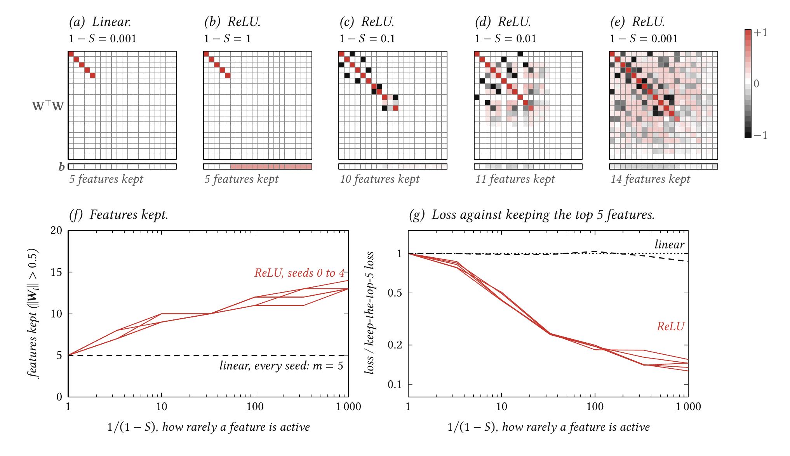
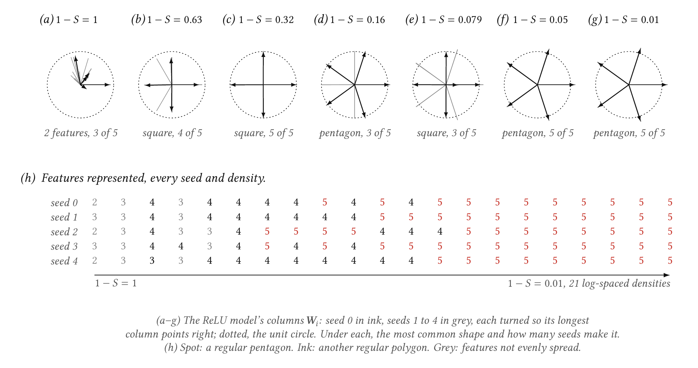
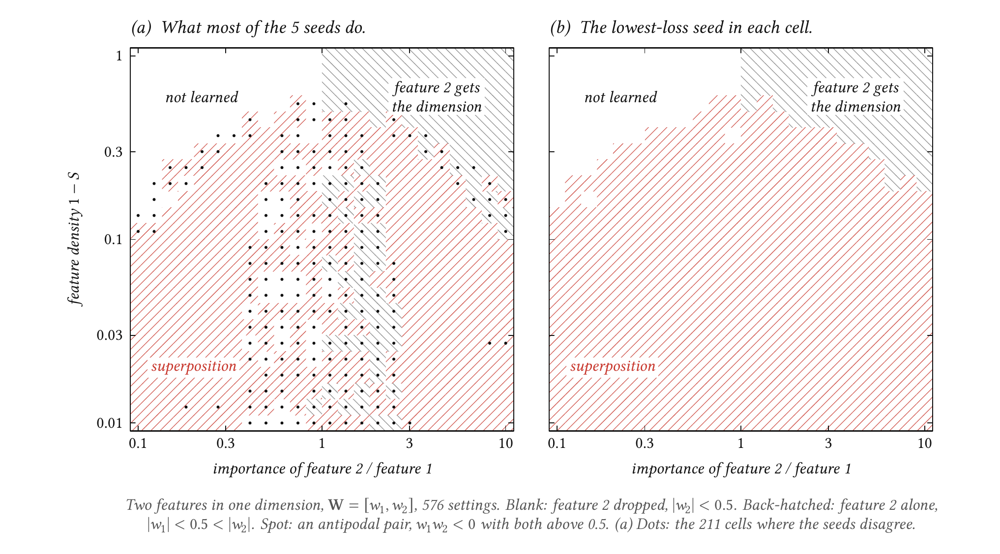
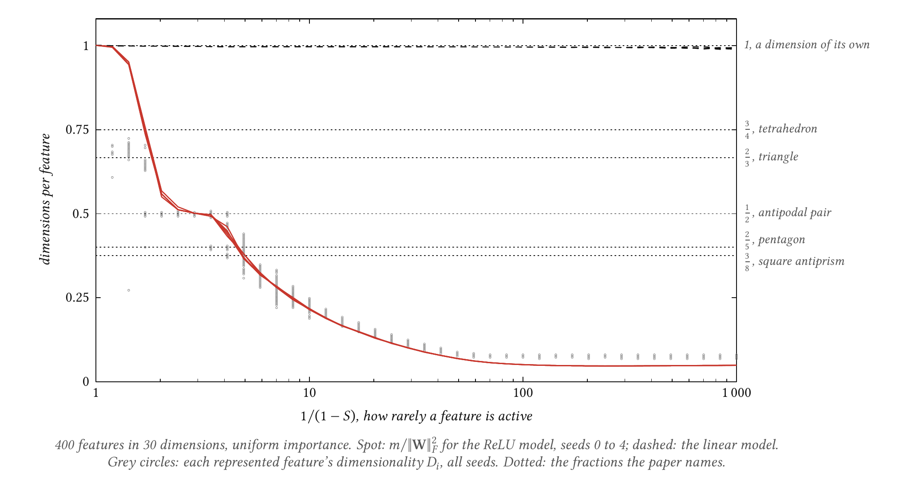

# sardines-mlp

**Toy models of superposition.** Reproducing toy models of superposition: how a network stores more features than it has dimensions.

**Status:** done. All four experiments of Elhage et al. 2022 reproduce, across five seeds each.

## Question

How does a network store more features than it has dimensions?

## Results

**When features are rare, a ReLU model stores more features than it has dimensions; a linear model never does.** The toy model squeezes n sparse features into m dimensions and reads them back out with the same matrix: x' = ReLU(WᵀWx + b). With 20 features in 5 dimensions, a linear model keeps exactly the 5 most important features at every sparsity, which is all PCA can do. The ReLU model does the same when features are dense. As they get rarer it keeps more and more features: 7–8 when each is active 30% of the time, 13–14 when each is active 0.1% of the time. Its loss falls to 13–15% of the best any 5-feature solution can do.



*__The linear model keeps 5 features at every sparsity; the ReLU model keeps up to 14, packed into the same 5 dimensions.__ Runs `intro-relu-seed0` to `seed4` and `intro-linear-seed0` to `seed4`, 20 features into 5 dimensions, importance Iᵢ = 0.7ⁱ, scored on 65,536 fresh samples. (a–e) Seed 0's WᵀW and b. Feature i's row of WᵀW is what the model reads out when only feature i is active: a spot diagonal cell means feature i comes back, and off-diagonal cells are interference from other features. The linear model (a) and the dense ReLU model (b) keep features 0–4 cleanly. The dense model's positive bias outputs the mean of the 15 dropped features. As features get rarer (c–e), less important features join, at first in antipodal pairs (each black off-diagonal cell in c is one: Wᵢ · Wⱼ ≈ −1), later in denser tangles. (f) Features with ‖Wᵢ‖ > 0.5, every seed. (g) Loss divided by the loss of the best 5-feature solution: the 5 most important features reconstructed perfectly and the other 15 replaced by their mean.*

| 1 − S | ReLU, seeds 0–4 | Linear | Keep the top 5 | Untrained | ReLU ÷ keep the top 5 | Features kept, ReLU |
| --- | --- | --- | --- | --- | --- | --- |
| 1 | 0.046–0.047 | 0.046–0.047 | 0.046 | 0.56–0.98 | 1.00 | 5 |
| 0.3 | 0.034–0.037 | 0.043 | 0.043 | 0.20–0.35 | 0.78–0.87 | 7–8 |
| 0.1 | 0.0075–0.0087 | 0.017 | 0.017 | 0.068–0.082 | 0.44–0.51 | 9–10 |
| 0.03 | 0.0013 | 0.0054 | 0.0055 | 0.023–0.029 | 0.24 | 10 |
| 0.01 | 0.00034–0.00037 | 0.0019 | 0.0018 | 0.0069–0.012 | 0.18–0.20 | 11–12 |
| 0.003 | 0.000078–0.00010 | 0.00053 | 0.00056 | 0.0021–0.0029 | 0.14–0.18 | 11–13 |
| 0.001 | 0.000023–0.000029 | 0.00016 | 0.00019 | 0.00060–0.00088 | 0.13–0.15 | 13–14 |

Losses are importance-weighted squared error per sample. Keep the top 5 is computed in closed form, not trained. The linear model matches it to within the noise of the 65,536 evaluation samples, which grows as features get rarer: at 1 − S = 0.001 each feature is active in only about 65 of them.

**Five features in two dimensions settle into a regular pentagon, in every seed, once features are active 5% of the time or less.** With uniform importance, nothing makes one feature special, and the best packing of five directions in a plane is a regular pentagon. Between dense and that point, the seeds disagree. At each density some seeds find a pentagon and others a square: four features as two antipodal pairs, with the fifth dropped. The paper warns that 2D models are hard to optimise and that it fitted each model several times and kept the best. Here every seed is shown.



*__Dense, the model keeps two or three features; sparse, a regular pentagon in all five seeds.__ Runs `polygons-relu-seed0` to `seed4`, 5 features into 2 dimensions, uniform importance, 21 densities from 1 to 0.01. (a–g) Each column Wᵢ is an arrow. Seed 0 is in ink, seeds 1–4 in grey, each rotated and reflected so its longest column points right, which changes nothing the model computes (WᵀW is unchanged). The pentagon's arrows reach slightly past the unit circle: the model sets a small negative bias to cut off interference and grows ‖Wᵢ‖ to make up for it, as the paper describes. (h) How many features each seed represents (‖Wᵢ‖ > 0.5), in spot where they form a regular pentagon and in ink for another regular polygon (a square, or a triangle). Grey marks features that are represented but not evenly spread.*

**With two features and one dimension, superposition takes over once features are rare, as the paper's phase diagram shows; but each seed gets stuck in a worse solution in about a sixth of the settings.** Feature 1 has importance 1 and feature 2 importance r. When features are dense, the one dimension goes to the more important feature: feature 2 is dropped for r < 1 and takes the dimension for r > 1. As features get rarer, the two share it as an antipodal pair, w₂ = −w₁, over a range of r that widens until it covers the whole grid from 1 − S ≈ 0.15 down. Taking each setting's lowest-loss seed, the way the paper picks its 2D solutions, gives that picture cleanly (b). (For its phase diagram the paper trains ten models per setting, drops the worst and averages the rest.) Any single seed does not: each of the five lands in a different phase from the lowest-loss one in 96–104 of the 576 settings. These are genuine local minima, not near-ties. Where seeds split, the best fit in the other phase has a median of 10 times the lowest loss. Most of them are a dropped or dedicated feature where the antipodal pair does better, around r ≈ 0.4–2.5 at low density (a).



*__Superposition fills the sparse half of the diagram; single fits often miss it near equal importance.__ Runs `phase-relu-seed0` to `seed4`: 576 settings, 24 relative importances by 24 densities, 2 features into 1 dimension. (a) The phase most seeds reach: superposition in 347 settings, feature 2 alone in 118 and feature 2 dropped in 111. The 211 dotted settings are those where the seeds disagree. (b) The phase of the seed with the lowest loss in each setting: superposition in 433 settings, feature 2 alone in 71 and dropped in 72. Panel (b) is a selection across seeds made on the evaluation loss. It shows what the best of five fits finds, not what a typical fit does.*

**With 400 features in 30 dimensions, the model sits at exactly half a dimension per feature over a range of sparsities, and individual features settle at ½, ⅖ and ⅜.** Dimensions per feature, m / ‖W‖²_F, is 30 over the number of features represented. It falls from 1 as features get rarer, then holds at 0.50 ± 0.01 for 1/(1 − S) from about 2.4 to 3.5 in every seed. There every represented feature is half of an antipodal pair. Per feature, the dimensionalities Dᵢ cluster at the fractions the paper names: 1,441 features within 0.01 of ½, 214 of ⅖ (pentagons) and 171 of ⅜ (square antiprisms). The linear model stays at 1, using 30 orthogonal directions, at every sparsity.

Not everything the paper shows appears. No feature settles at ¾ (the tetrahedron). Near the dense end the Dᵢ spread between 0.61 and 0.72, around ⅔ rather than on it. From 1/(1 − S) ≈ 84 on, all 400 features are represented. The curve then flattens at 0.049, below 30/400 = 0.075, because each ‖Wᵢ‖ grows to 1.18–1.30 to offset the negative bias that filters out interference.



*__Half a dimension per feature, held over a range of sparsities, and per-feature clusters at ½, ⅖ and ⅜.__ Runs `dimensionality-relu-seed0` to `seed4` and `dimensionality-linear-seed0` to `seed4`: 400 features into 30 dimensions, uniform importance, 40 sparsities. The five ReLU seeds (spot) lie almost on top of each other. Grey circles: the dimensionality Dᵢ of every represented feature in every seed (49,215 features, merged where they coincide at the drawn resolution). Dotted lines: the fractions the paper identifies with specific geometries.*

## How it works

The owner knows MLPs and PCA. This is what is new here.

- **Features.** The model's input is n synthetic features. Each is 0 with probability S, the sparsity, and otherwise uniform on [0, 1]. Feature i has an importance Iᵢ, a weight in the loss: L = E[Σᵢ Iᵢ (xᵢ − x'ᵢ)²]. Real networks plausibly see many more potential features than they have neurons, most of them rarely active, and some mattering more than others. This toy has those three properties and nothing else.
- **Tied weights.** h = Wx compresses the n features to m < n numbers, and x' = ReLU(Wᵀh + b) reads them back with the same matrix. Column Wᵢ is then unambiguously "the direction for feature i". WᵀW holds every pair's overlap: Wᵢ · Wⱼ is how much of feature j comes out on feature i's output.
- **Why the linear model can't do it.** Without the ReLU, interference is symmetric and always costs. Two features sharing a direction pollute each other whenever either is active, so the best the linear model can do is give m features orthogonal directions and drop the rest. That is PCA on the importance-weighted features.
- **Why sparsity and the ReLU make superposition pay.** If features are rarely active together, two features can share a dimension with opposite signs, an antipodal pair: Wⱼ = −Wᵢ. When only feature i is on, feature j's output is negative, and the ReLU clips it to zero for free. The pair only collides when both are on at once, which at sparsity S happens with probability (1 − S)². A small negative bias also cuts off small positive interference from directions that aren't exactly opposite, such as a pentagon's neighbours. The cost is a slightly longer Wᵢ to compensate (‖Wᵢ‖ ≈ 1/(1 − bᵢ)).
- **Feature dimensionality.** Dᵢ = ‖Wᵢ‖² / Σⱼ (Ŵᵢ · Wⱼ)², where Ŵᵢ is Wᵢ scaled to unit length, measures what fraction of a dimension feature i gets. It is 1 for a feature with its own orthogonal direction, ½ for each member of an antipodal pair, ⅖ for a pentagon's vertex, and 0 for a dropped feature.
- **Many models at once.** Every sweep trains all its settings as one batched model. W has shape (instances, m, n) and each instance only sees its own slice of every batch. The instances' losses are summed, and since each one's gradient comes only from its own term and Adam scales every weight on its own, they train as independent models (`tests/test_model.py` checks this).

## Experiment

Four sweeps follow the paper's settings where its text gives them (`src/sardines_mlp/experiments.py`):

| Sweep | n → m | Importance | Settings, one instance each |
| --- | --- | --- | --- |
| `intro` | 20 → 5 | 0.7ⁱ | 1 − S ∈ {1, 0.3, 0.1, 0.03, 0.01, 0.003, 0.001} |
| `polygons` | 5 → 2 | uniform | 21 densities, log-spaced from 1 to 0.01 |
| `phase` | 2 → 1 | 1 and r | 24 × 24 grid: r from 0.1 to 10, density from 1 to 0.01, both log-spaced |
| `dimensionality` | 400 → 30 | uniform | 40 densities, 1/(1 − S) log-spaced from 1 to 1,000 |

- **Training.** Adam, learning rate 1e-3, batches of 1,024 fresh samples, 30,000 steps, no weight decay. W starts Xavier-normal per instance and b at 0. The step count was chosen on a development seed (100): at 10,000 steps the sparsest instances were still improving.
- **Evaluation.** Every instance is scored on 65,536 fresh samples from a generator seeded separately from training, the same samples for every run on the same device type. There is no dataset to leak, so fresh samples are the held-out set.
- **Seeds.** Each sweep and model runs with seeds 0–4, all reported. Where seeds disagree, the README shows the disagreement rather than a chosen seed.
- **Baselines.** The linear model on the same grid and seeds. The closed-form loss of keeping the top m features and replacing the rest with their mean. The untrained model, and outputting zero.

Reproduce everything (about an hour on an RTX 3060 and a 24-core CPU):

```sh
just bg sweep                            # all 40 runs in tmux, each analysed, then compared across seeds
just figure-data                         # copy the figures' numbers out of runs/ into figures/data/
just figures
```

or skip training and download the runs from Hugging Face:

```sh
uv run hf download coeiico/sardines-mlp --local-dir runs  # every run and comparison, about 95 MB
just predict polygons-relu-seed0 --instance 13             # reconstruct fresh samples with the saved weights
just figure-data && just figures                           # redraw the README figures from the downloaded analyses
```

or train one run at a time:

```sh
just train --experiment polygons --seed 0 --run-name polygons-relu-seed0
just train --experiment polygons --seed 0 --model.activation none --run-name polygons-linear-seed0
just analyze polygons-relu-seed0         # geometry, baselines and plots in runs/polygons-relu-seed0/analysis/
just compare polygons                    # cross-seed tables in runs/compare-polygons/
```

## Tests

`just test` runs 26 tests in about 5 seconds:

- **Features:** the share of active features matches 1 − S, values lie in [0, 1], the mean and variance match their closed forms, and a seed repeats its batch.
- **Loss and forward pass:** both checked against values worked out by hand on tiny inputs.
- **Tied weights:** W's gradient equals the sum of the gradients of an untied encoder and decoder copy, and matches finite differences.
- **Independence:** changing one instance's inputs leaves another instance's gradient unchanged.
- **Learning:** with room for every feature (n = m = 2), the loss goes to about 0.
- **Geometry:** on hand-built weights, an antipodal pair gives Dᵢ = ½, a regular pentagon ⅖, a tetrahedron ¾ and orthogonal features 1. The four n = 2, m = 1 phases are classified correctly.
- **Runs:** a saved and reloaded run gives identical outputs and evaluation.

## Done when

The general checklist:

Apply this checklist with the project-specific requirements and exceptions in
[CLAUDE.md](CLAUDE.md#project-specific-scope).

- `just quick` runs end to end on CPU in under 5 minutes, as a smoke test. It takes about 10 seconds.
- The full run fits on one consumer GPU (8–12 GB VRAM) and auto-detects cuda, mps or cpu.
- Each run saves weights, `metrics.json` and its plots to `runs/<run-name>/`.
- This README shows the headline result with plots, compares against baselines, and states negative results plainly.
- Tests cover data generators, tensor shapes and one tiny overfit check.

## Notes

- These models are too small to gain from a GPU: the `intro`, `polygons` and `phase` sweeps train faster on one CPU core each. `sweep.sh` runs those on the CPU with the GPU hidden, since PyTorch's Adam otherwise opens a CUDA context in every process.
- **Hugging Face.** All 40 runs in this README, with weights, the per-instance feature settings, `metrics.json`, plots and their analysis, are at [coeiico/sardines-mlp](https://huggingface.co/coeiico/sardines-mlp), one folder per run, beside the four cross-seed comparisons (`compare-*`). Download them into `runs/` to analyse or redraw without training (below). `just push <run>` uploads one run.
- **Data.** There is no dataset: every sample is generated from its sparsity and seed (`features.py`), so a run's `metrics.json` is enough to regenerate its data.
- Not done: the paper's n = 3, m = 2 phase diagram, its closed-form ("theoretical") phase diagram, and its correlated-feature experiments.

## Quickstart

Needs [uv](https://docs.astral.sh/uv/), [just](https://just.systems/) and, for `just bg`, tmux. Everything else, Python 3.12 included, comes from uv.

```sh
just setup              # uv sync, then install the pre-commit hooks
just quick              # CPU smoke test, under 5 minutes
just train              # full run; flags pass through, e.g. --experiment intro --run-name intro-relu-seed0
just bg train ...       # the same, in a detached tmux session; any recipe works
just analyze <run>      # geometry, baselines and plots for a saved run
just compare <sweep>    # one sweep's geometry across seeds
just sweep              # every reported run; start it with just bg sweep
just figures            # the README figures, drawn in LaTeX
just test               # pytest
just check              # ruff and basedpyright, as in CI
```

Copy `.env.example` to `.env` (gitignored) for `HF_TOKEN` and `HF_USER`.

## Layout

```
sardines-mlp/
├── README.md                goal, results with plots, how it works
├── CLAUDE.md                instructions for coding agents; AGENTS.md points here
├── .agents/                 instructions/ (Python formatting, commits) and plans/
├── pyproject.toml           metadata, dependencies, tool settings
├── uv.lock                  committed lockfile
├── .python-version          pinned by uv
├── justfile                 every routine command
├── .pre-commit-config.yaml
├── .github/workflows/ci.yml
├── src/sardines_mlp/
│   ├── features.py          sparse feature sampling and closed-form baselines
│   ├── model.py             the tied-weight toy model and its weighted loss
│   ├── experiments.py       the four sweeps
│   ├── evaluation.py        scoring on fresh samples
│   ├── geometry.py          norms, superposition, Dᵢ, phases, polygons
│   ├── analysis.py          per-instance and per-feature tables
│   ├── checkpoint.py        saving and loading a run
│   └── utils.py             devices, seeds, run folders, code state
├── train.py                 CLI; --quick runs the CPU smoke test
├── predict.py               reconstruct a few fresh samples from a saved run
├── analyze.py               geometry, baselines and diagnostic plots for a saved run
├── compare.py               one sweep's geometry across seeds
├── sweep.sh                 every reported run, two queues (CPU and GPU)
├── cloud.py                 the same runs on Modal (unused here: the models are tiny)
├── figures/                 README figures: LaTeX sources, data and built PNGs
├── notebooks/               marimo notebooks for exploration
├── tests/
└── runs/                    outputs, gitignored
```

## Sources

- Elhage et al. 2022, [Toy Models of Superposition](https://transformer-circuits.pub/2022/toy_model/index.html) ([arXiv:2209.10652](https://arxiv.org/abs/2209.10652))

## License

MIT
